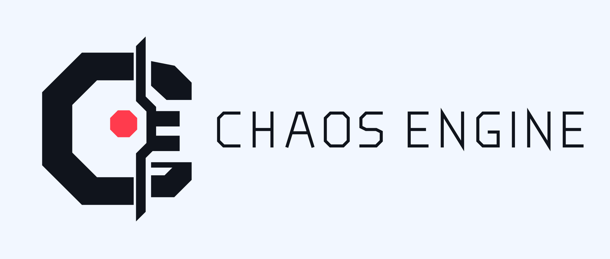

<p align="center">
  <picture>
    <source media="(prefers-color-scheme: dark)" srcset="assets/brand/lockup-dark.svg">
    <source media="(prefers-color-scheme: light)" srcset="assets/brand/lockup-light.svg">
    
  </picture>
</p>

# ChaosEngine

ChaosEngine is a portable, provider-neutral working contract for software agents. Testers, developers, product owners and scrum masters install it into a project so their coding agents (Claude Code, Codex, Gemini CLI, Grok, GitHub Copilot, OpenCode, Cursor, Grok Bot) follow one loop: research first, plan, implement, verify with evidence, get an adversarial review, and record what was learned. Agents load [skills/chaos-engine/SKILL.md](skills/chaos-engine/SKILL.md); people start with the [overview](guides/overview.md).

## Quick start

There are two install channels:

- **Latest from `main` (available now):** the one-liner below. Run it in your project directory; no Python is needed beforehand. It installs from this repository's `main` and pins the exact commit in the install receipt.
- **Weekly releases (not live yet):** the `chaosengine-harness` packages on PyPI and npm. Today they are reserved `0.0.1` placeholders that do not install this harness.

macOS or Linux:

```bash
curl -fsSL "https://raw.githubusercontent.com/ShaftHQ/chaosengine-harness/main/install.sh" | bash -s -- "https://raw.githubusercontent.com/ShaftHQ/chaosengine-harness/main/install.sh"
```

Windows PowerShell:

```powershell
irm "https://raw.githubusercontent.com/ShaftHQ/chaosengine-harness/main/install.ps1" | iex
```

## Pin, verify, uninstall

`--version <40-hex>` pins a commit. A release pin is refused when its `.sha256` does not match. `verify` names drift. `uninstall` keeps edited files. A SHAFT project gets version-pinned skills; `--without-shaft-engine-users` opts out until `--with-shaft-engine-users`.

The installer runs doctor before it finishes. For later health checks, see [INSTALL.md](INSTALL.md).

## Docs

- [Overview](guides/overview.md): roles, the delivery loop, supported hosts, concepts, status
- [INSTALL.md](INSTALL.md): host flags, add-ons, offline bundles, upgrade, rollback, uninstall
- [Architecture](guides/architecture.md): lifecycle, ownership, trust boundaries, companions
- [CHANGELOG.md](CHANGELOG.md): version `0.4.20261115.5` ([VERSION](VERSION))
- Role starts: [tester](guides/start-tester.md), [frontend developer](guides/start-frontend-developer.md), [backend developer](guides/start-backend-developer.md), [product owner](guides/start-product-owner.md), [scrum master](guides/start-scrum-master.md)
- Tool pages: [Grok](guides/tools/grok.md), [Claude Code](guides/tools/claude.md), [Codex](guides/tools/codex.md), [Gemini CLI](guides/tools/gemini.md), [Cursor](guides/tools/cursor.md)

## Contributing and license

See [CONTRIBUTING.md](CONTRIBUTING.md), [CODE_OF_CONDUCT.md](CODE_OF_CONDUCT.md), [SECURITY.md](SECURITY.md) and the generated [ROADMAP.md](ROADMAP.md). MIT licensed, copyright ChaosEngine contributors: [LICENSE](LICENSE), [THIRD_PARTY_NOTICES.md](THIRD_PARTY_NOTICES.md).

<details>
<summary>Generated inventory and evidence (maintained by repository tooling)</summary>

## Reference: source-derived inventory

Repository validators parse the delimited blocks in this section. Keep each
block, and the heading directly above it, unchanged.

## OmniRoute decision-quality evidence

Transparent side-by-side results from the free OmniRoute walking skeleton
(#5522 / #5465). Values below are generated from the committed aggregate and
are published regardless of positive, neutral, negative, or inconclusive
outcome.

<!-- evidence:omniroute-calibration:start -->
This section is generated from
[`decision-quality-calibration.aggregate.json`](decision-quality-calibration.aggregate.json).
Do not hand-edit the numbers; refresh with
`python3 scripts/ci/validate_chaos_engine_readme.py --write`.

Label: **directional walking skeleton** (n=12/12 observed/planned trials).
This is not a Harbor 95% CI powered pilot.

| Field | Value |
| --- | --- |
| Gate verdict | NO |
| Gate reason | correctness did not beat control |
| Correctness delta (treatment - control) | 0.0 |
| Models used | nvidia/nemotron-3-ultra-550b-a55b |
| Preferred model | agy/gemini-3.7-flash-high |
| Tasks | diagnosis-failure-trace, repair-regression-test, delivery-focused-proof |
| Status | complete |

| Metric | control | chaos-engine |
| --- | --- | --- |
| `correctness` | 0.0 | 0.0 |
| `tokens` | 351.6666666666667 | 371.1666666666667 |
| `latency_seconds` | 24.54195623733055 | 36.893572025665584 |
| `external_run_minutes` | UNAVAILABLE | UNAVAILABLE |
| `actions` | 1.0 | 1.0 |
| `retries` | 0.0 | 0.0 |
| `cost_usd` | UNAVAILABLE | UNAVAILABLE |
| `variance` | 0.0 | 0.0 |

Methodology and final report:
[decision-quality-calibration.md](decision-quality-calibration.md),
[decision-quality-report.md](decision-quality-report.md).
Missing telemetry remains the literal `UNAVAILABLE` (never `0`).
<!-- evidence:omniroute-calibration:end -->

## Source-derived inventory

These tables are generated from the dependency manifest, Python imports, skill
catalogs, lifecycle event registry, and host capability map. Their text remains
usable without Mermaid; unknown source entries fail the inventory validator.

### Prerequisites

<!-- inventory:prerequisites:start -->
| Item | Purpose | Source of truth | Status | Platforms | Provisioner | Owner | Failure behavior |
| --- | --- | --- | --- | --- | --- | --- | --- |
| Latest stable Python | Run bootstrap, installer, kernel, and tools without old-runtime defects. | install.ps1; install.sh; dependencies.json | managed | Windows, Linux, macOS | uv managed Python | user account | install stops before activation |
| PowerShell or POSIX shell | Launch the reviewed bootstrap wrapper. | install.ps1; install.sh | required | platform native | operating system | consumer environment | bootstrap does not start |
| curl or wget | Download immutable source on POSIX. | install.sh | required on POSIX | Linux, macOS | operator | consumer environment | download fails closed |
| Node.js, npm, and npx | Provision Memory, Context7 CLI, and plugin MCP runtimes. | dependencies.json; hooks/launch.js | managed | Windows, Linux, macOS | platform standard provider | user account | install stops before activation |
| network | Resolve source and provision a fresh or upgraded generation. | bootstrap.py; dependencies.py | required for fresh install or upgrade | Windows, Linux, macOS | operator | prior verified generation remains active |
| Git, managed Temurin JDK 25+, and managed Apache Maven | Build optional Maven Tools MCP cache when ambient JDK/Maven are missing. | dependencies.json; install.py; hosts.py | optional and managed with `--with-maven-tools` | Windows, Linux, macOS | managed Temurin/Maven cache plus upstream Maven wrapper | receipt-owned shared cache | optional component reports absent |
<!-- inventory:prerequisites:end -->

### Python Libraries

<!-- inventory:python-libraries:start -->
| Item | Purpose | Source of truth | Status | Platforms | Provisioner | Owner | Failure behavior |
| --- | --- | --- | --- | --- | --- | --- | --- |
| argparse | Portable runtime standard-library dependency. | addons/design-skills/scripts/design_qc.py, addons/design-skills/scripts/title_scope_gate.py, backups_watch.py, bootstrap.py, ce_brief.py, commit_identity.py, content_scan_preflight.py, context_rot.py, deep_research.py, dependencies.py, draft_skill_pr.py, external_reflection.py, genai_spans.py, harness_index.py, harness_map.py, heuristics.py, hooks/receipt_shim.py, hooks/reflection.py, insight_extract.py, install.py, jobs.py, learn_traces.py, learning.py, learning_session.py, memory_provenance.py, mempalace_privacy.py, meta_optimize.py, phase_ledger.py, profile_installs.py, prompt_evolve.py, references/details/likeness_record_train.py, retrieve.py, rules/memory_full_dump.py, self_modify.py, session_token_usage.py, significance.py, silent_verify.py, skill_compress_audit.py, skills/colibri/scripts/probe.py, skills/freetoken/scripts/probe.py, skills/local-agency/scripts/assert_parent_rog_shell.py, skills/local-agency/scripts/design_turn_gate.py, skills/local-agency/scripts/dispatch.py, skills/local-agency/scripts/executor_brief.py, skills/local-agency/scripts/require_rog_freetoken.py, skills/local-agency/scripts/tip_preflight.py, skills/local-agency/scripts/worker_ce_entry.py, skills/local-coding-delegate/scripts/probe_hardware.py, skills/local-openai-compat/scripts/probe.py, skills/omniroute/scripts/runner.py, task_ledger.py, wake_pack.py, workflow_induce.py, worktree_overlay.py | required | Windows, Linux, macOS | resolved latest stable Python | Python runtime | affected command fails closed |
| array | Portable runtime standard-library dependency. | addons/design-skills/scripts/design_qc.py | required | Windows, Linux, macOS | resolved latest stable Python | Python runtime | affected command fails closed |
| ast | Portable runtime standard-library dependency. | harness_map.py, skills/local-agency/scripts/tip_preflight.py | required | Windows, Linux, macOS | resolved latest stable Python | Python runtime | affected command fails closed |
| atexit | Portable runtime standard-library dependency. | install.py | required | Windows, Linux, macOS | resolved latest stable Python | Python runtime | affected command fails closed |
| base64 | Portable runtime standard-library dependency. | hosts.py, install.py, secret_guard.py, skills/local-agency/scripts/require_rog_freetoken.py | required | Windows, Linux, macOS | resolved latest stable Python | Python runtime | affected command fails closed |
| binascii | Portable runtime standard-library dependency. | secret_guard.py | required | Windows, Linux, macOS | resolved latest stable Python | Python runtime | affected command fails closed |
| bisect | Portable runtime standard-library dependency. | vendor/icm-architect/skills/icm-architect/scripts/quotes.py | required | Windows, Linux, macOS | resolved latest stable Python | Python runtime | affected command fails closed |
| collections | Portable runtime standard-library dependency. | bootstrap.py, hooks/guard.py, hooks/lifecycle.py, learn_traces_mrv.py, mcp_policy.py, rules_source.py, silent_verify.py | required | Windows, Linux, macOS | resolved latest stable Python | Python runtime | affected command fails closed |
| concurrent | Portable runtime standard-library dependency. | addons/design-skills/scripts/linkcheck.py, bootstrap.py | required | Windows, Linux, macOS | resolved latest stable Python | Python runtime | affected command fails closed |
| contextlib | Portable runtime standard-library dependency. | bootstrap.py, dependencies.py, grok_lean_config.py, hooks/guard.py, hooks/kernel.py, hooks/lifecycle.py, hosts.py, install.py, jobs.py, learning.py, learning_session.py, pack_binding.py, packs/java/installer.py, packs/java/maven_tools.py, silent_verify.py, skills/omniroute/scripts/runner.py, stores.py | required | Windows, Linux, macOS | resolved latest stable Python | Python runtime | affected command fails closed |
| ctypes | Portable runtime standard-library dependency. | bootstrap.py, dependencies.py, hosts.py, jobs.py, prerequisites.py, skills/local-coding-delegate/scripts/probe_hardware.py | required | Windows, Linux, macOS | resolved latest stable Python | Python runtime | affected command fails closed |
| dataclasses | Portable runtime standard-library dependency. | hooks/kernel.py, mobile_retro.py, rules/memory_full_dump.py | required | Windows, Linux, macOS | resolved latest stable Python | Python runtime | affected command fails closed |
| datetime | Portable runtime standard-library dependency. | deep_research.py, dependencies.py, harness_mindset.py, hooks/reflection.py, hosts.py, learn_traces.py, learn_traces_mrv.py, progress_log.py, rules/ethics_check.py, skills/omniroute/scripts/runner.py | required | Windows, Linux, macOS | resolved latest stable Python | Python runtime | affected command fails closed |
| difflib | Portable runtime standard-library dependency. | addons/design-skills/scripts/craft_qc.py, addons/design-skills/scripts/design_qc.py, addons/design-skills/scripts/surface_qc.py, worktree_overlay.py | required | Windows, Linux, macOS | resolved latest stable Python | Python runtime | affected command fails closed |
| email | Portable runtime standard-library dependency. | bootstrap.py | required | Windows, Linux, macOS | resolved latest stable Python | Python runtime | affected command fails closed |
| errno | Portable runtime standard-library dependency. | dependencies.py, hooks/launch.py, hosts.py, packs/java/maven_tools.py | required | Windows, Linux, macOS | resolved latest stable Python | Python runtime | affected command fails closed |
| fcntl | Portable runtime standard-library dependency. | dependencies.py, grok_lean_config.py, hooks/kernel.py, install.py, learning.py, packs/java/maven_tools.py, stores.py | required | Windows, Linux, macOS | resolved latest stable Python | Python runtime | affected command fails closed |
| fnmatch | Portable runtime standard-library dependency. | bootstrap.py, delete_guard.py, secret_guard.py | required | Windows, Linux, macOS | resolved latest stable Python | Python runtime | affected command fails closed |
| functools | Portable runtime standard-library dependency. | mobile_retro.py, pack_binding.py | required | Windows, Linux, macOS | resolved latest stable Python | Python runtime | affected command fails closed |
| glob | Portable runtime standard-library dependency. | addons/design-skills/scripts/design_qc.py, delete_guard.py | required | Windows, Linux, macOS | resolved latest stable Python | Python runtime | affected command fails closed |
| grp | Portable runtime standard-library dependency. | skills/omniroute/scripts/runner.py | required | Windows, Linux, macOS | resolved latest stable Python | Python runtime | affected command fails closed |
| hashlib | Portable runtime standard-library dependency. | addon_catalog.py, addons/design-skills/scripts/design_qc.py, addons/design-skills/scripts/motion_graphics_gate.py, backups_watch.py, bootstrap.py, conformance.py, context_rot.py, delete_guard.py, dependencies.py, external_reflection.py, genai_spans.py, harness_mindset.py, heuristics.py, hooks/guard.py, hooks/kernel.py, hooks/reflection.py, hosts.py, insight_extract.py, install.py, learning.py, learning_session.py, overlay_match.py, packs/java/maven_tools.py, prompt_evolve.py, references/details/likeness_record_train.py, rules/ethics_check.py, rules/memory_full_dump.py, rules/web_ui_gate.py, self_modify.py, significance.py, skills/local-agency/scripts/tip_preflight.py, skills/omniroute/scripts/runner.py, stores.py, supply_chain.py, token_economy.py, tool.py, workflow_induce.py, worktree_overlay.py | required | Windows, Linux, macOS | resolved latest stable Python | Python runtime | affected command fails closed |
| hmac | Portable runtime standard-library dependency. | delete_guard.py, hooks/reflection.py, hosts.py | required | Windows, Linux, macOS | resolved latest stable Python | Python runtime | affected command fails closed |
| html | Portable runtime standard-library dependency. | addons/design-skills/scripts/hosted_cms_gates.py, addons/design-skills/scripts/liveseo_gates.py, addons/design-skills/scripts/surface_qc.py | required | Windows, Linux, macOS | resolved latest stable Python | Python runtime | affected command fails closed |
| importlib | Portable runtime standard-library dependency. | addons/design-skills/scripts/craft_qc.py, addons/design-skills/scripts/design_qc.py, addons/design-skills/scripts/uncaptioned_speech.py, bootstrap.py, corpus_split.py, dependencies.py, draft_skill_pr.py, heuristics.py, hooks/guard.py, hooks/kernel.py, hooks/launch.py, hooks/lifecycle.py, hooks/retrieve_justification.py, hosts.py, insight_extract.py, install.py, learn_traces.py, learning.py, learning_session.py, mcp_policy.py, mempalace_fast_mine.py, mempalace_privacy.py, meta_optimize.py, official_self_heal.py, overlay_match.py, pack_binding.py, packs/java/maven_tools.py, packs/shaft/sync.py, retrieve.py, rules/ethics_check.py, rules/lessons_2026_11_02.py, rules/lessons_2026_11_06.py, rules/operation_boundary.py, session_logs.py, silent_verify.py, skills/local-agency/scripts/dispatch.py, skills/local-agency/scripts/require_rog_freetoken.py, skills/local-agency/scripts/tests/test_assert_parent_rog_shell.py, skills/local-agency/scripts/tip_preflight.py, skills/local-coding-delegate/hardware_probe.py, stores.py, task_ledger.py, token_economy.py, tool.py, worktree_overlay.py | required | Windows, Linux, macOS | resolved latest stable Python | Python runtime | affected command fails closed |
| inspect | Portable runtime standard-library dependency. | install.py, mempalace_fast_mine.py | required | Windows, Linux, macOS | resolved latest stable Python | Python runtime | affected command fails closed |
| io | Portable runtime standard-library dependency. | bootstrap.py, hooks/guard.py, hooks/launch.py, hooks/lifecycle.py, overlay_match.py | required | Windows, Linux, macOS | resolved latest stable Python | Python runtime | affected command fails closed |
| json | Portable runtime standard-library dependency. | addon_catalog.py, addons/design-skills/scripts/craft_qc.py, addons/design-skills/scripts/design_qc.py, addons/design-skills/scripts/linkcheck.py, addons/design-skills/scripts/liveseo_gates.py, addons/design-skills/scripts/motion_graphics_gate.py, addons/design-skills/scripts/surface_qc.py, addons/design-skills/scripts/title_scope_gate.py, addons/design-skills/scripts/uncaptioned_speech.py, backups_watch.py, bootstrap.py, ce_brief.py, conformance.py, context_rot.py, corpus_split.py, deep_research.py, delete_guard.py, dependencies.py, dod.py, draft_skill_pr.py, external_reflection.py, gate_fail_closed.py, genai_spans.py, grok_lean_config.py, harness_index.py, harness_map.py, harness_mindset.py, heuristics.py, honesty.py, hooks/guard.py, hooks/kernel.py, hooks/launch.py, hooks/lifecycle.py, hooks/receipt_shim.py, hooks/reflection.py, hooks/repeat_reminder.py, hooks/retrieve_justification.py, hosts.py, insight_extract.py, install.py, intent_converge.py, jobs.py, learn_traces.py, learn_traces_mrv.py, learning.py, learning_counters.py, learning_session.py, mcp_policy.py, memory_provenance.py, meta_optimize.py, mobile_retro.py, official_self_heal.py, overlay_match.py, packs/java/installer.py, packs/java/maven_tools.py, packs/shaft/detect.py, packs/shaft/sync.py, phase_ledger.py, pre_done_review.py, prerequisites.py, profile_installs.py, prompt_evolve.py, references/details/likeness_record_train.py, retrieve.py, rules/ethics_check.py, rules/lessons_repeat_failure_pdca.py, rules/memory_full_dump.py, rules/operation_boundary.py, secret_guard.py, self_modify.py, session_token_usage.py, significance.py, skill_compress_audit.py, skills/colibri/scripts/probe.py, skills/freetoken/scripts/probe.py, skills/local-agency/scripts/assert_parent_rog_shell.py, skills/local-agency/scripts/design_turn_gate.py, skills/local-agency/scripts/dispatch.py, skills/local-agency/scripts/executor_brief.py, skills/local-agency/scripts/require_rog_freetoken.py, skills/local-agency/scripts/tests/test_assert_parent_rog_shell.py, skills/local-agency/scripts/tip_preflight.py, skills/local-coding-delegate/scripts/probe_hardware.py, skills/local-openai-compat/scripts/probe.py, skills/omniroute/scripts/runner.py, stores.py, task_ledger.py, token_economy.py, tool.py, vendor/icm-architect/skills/icm-architect/scripts/index.py, vendor/icm-architect/skills/icm-architect/scripts/links.py, vendor/icm-architect/skills/icm-architect/scripts/viz.py, wake_pack.py, workflow_induce.py, worktree_overlay.py | required | Windows, Linux, macOS | resolved latest stable Python | Python runtime | affected command fails closed |
| math | Portable runtime standard-library dependency. | addons/design-skills/scripts/craft_qc.py, addons/design-skills/scripts/design_qc.py, addons/design-skills/scripts/hosted_cms_gates.py, addons/design-skills/scripts/surface_qc.py, dependencies.py | required | Windows, Linux, macOS | resolved latest stable Python | Python runtime | affected command fails closed |
| msvcrt | Portable runtime standard-library dependency. | dependencies.py, grok_lean_config.py, hooks/kernel.py, install.py, learning.py, packs/java/maven_tools.py, stores.py | required | Windows, Linux, macOS | resolved latest stable Python | Python runtime | affected command fails closed |
| multiprocessing | Portable runtime standard-library dependency. | mobile_retro.py | required | Windows, Linux, macOS | resolved latest stable Python | Python runtime | affected command fails closed |
| os | Portable runtime standard-library dependency. | addon_catalog.py, addons/design-skills/scripts/craft_qc.py, addons/design-skills/scripts/design_qc.py, addons/design-skills/scripts/linkcheck.py, backups_watch.py, bootstrap.py, chaosengine_harness.py, client_name_scrub.py, commit_identity.py, consumer_mode.py, delete_guard.py, dependencies.py, draft_skill_pr.py, git_hooks.py, grok_lean_config.py, grok_model_load.py, harness_mindset.py, hooks/guard.py, hooks/kernel.py, hooks/launch.py, hooks/lifecycle.py, hooks/receipt_shim.py, hooks/reflection.py, hooks/retrieve_justification.py, hosts.py, install.py, jobs.py, learn_traces.py, learning.py, learning_session.py, mcp_policy.py, mempalace_fast_mine.py, mobile_retro.py, official_self_heal.py, overlay_match.py, packs/java/installer.py, packs/java/maven_tools.py, packs/shaft/detect.py, packs/shaft/sync.py, prerequisites.py, progress_log.py, radio_silence.py, retrieve.py, secret_guard.py, session_logs.py, session_token_usage.py, significance.py, skills/job-apply/scripts/check_abstraction.py, skills/job-search/scripts/check_abstraction.py, skills/local-agency/scripts/assert_parent_rog_shell.py, skills/local-agency/scripts/require_rog_freetoken.py, skills/local-coding-delegate/scripts/probe_hardware.py, skills/omniroute/scripts/runner.py, stores.py, task_ledger.py, tool.py, vendor/icm-architect/skills/icm-architect/scripts/links.py, vendor/icm-architect/skills/icm-architect/scripts/viz.py, windows_py_shim.py, worktree_overlay.py | required | Windows, Linux, macOS | resolved latest stable Python | Python runtime | affected command fails closed |
| pathlib | Portable runtime standard-library dependency. | addon_catalog.py, addons/design-skills/scripts/craft_qc.py, addons/design-skills/scripts/design_qc.py, addons/design-skills/scripts/linkcheck.py, addons/design-skills/scripts/liveseo_gates.py, addons/design-skills/scripts/motion_graphics_gate.py, addons/design-skills/scripts/surface_qc.py, addons/design-skills/scripts/title_scope_gate.py, addons/design-skills/scripts/uncaptioned_speech.py, backups_watch.py, bootstrap.py, ce_brief.py, chaosengine_harness.py, client_name_scrub.py, commit_identity.py, conformance.py, consumer_mode.py, content_scan_preflight.py, context_rot.py, corpus_split.py, deep_research.py, delete_guard.py, dependencies.py, draft_skill_pr.py, external_reflection.py, force_push_approve.py, gate_fail_closed.py, genai_spans.py, git_hooks.py, grok_lean_config.py, grok_model_load.py, handoff_receipt.py, harness_index.py, harness_map.py, harness_mindset.py, heuristics.py, honesty.py, hooks/guard.py, hooks/kernel.py, hooks/launch.py, hooks/lifecycle.py, hooks/receipt_shim.py, hooks/reflection.py, hooks/retrieve_justification.py, hosts.py, identity_md.py, insight_extract.py, install.py, intent_converge.py, jobs.py, learn_traces.py, learn_traces_mrv.py, learning.py, learning_counters.py, learning_session.py, mcp_policy.py, memory_provenance.py, mempalace_fast_mine.py, mempalace_privacy.py, meta_optimize.py, mobile_retro.py, official_self_heal.py, overlay_match.py, pack_binding.py, packs/java/installer.py, packs/java/maven_tools.py, packs/shaft/detect.py, packs/shaft/sync.py, phase_ledger.py, pre_done_review.py, prerequisites.py, profile_installs.py, progress_log.py, prompt_evolve.py, radio_silence.py, references/details/likeness_record_train.py, retrieve.py, rules/ethics_check.py, rules/lessons_2026_11_01.py, rules/lessons_2026_11_02.py, rules/lessons_2026_11_06.py, rules/lessons_l82_l92.py, rules/lessons_repeat_failure_pdca.py, rules/memory_full_dump.py, rules/no_probe_live.py, rules/operation_boundary.py, rules/remote_credential_guard.py, rules/web_ui_gate.py, rules_source.py, secret_guard.py, self_modify.py, session_logs.py, session_token_usage.py, significance.py, silent_verify.py, skill_compress_audit.py, skills/job-apply/scripts/check_abstraction.py, skills/job-search/scripts/check_abstraction.py, skills/local-agency/scripts/assert_parent_rog_shell.py, skills/local-agency/scripts/design_turn_gate.py, skills/local-agency/scripts/dispatch.py, skills/local-agency/scripts/executor_brief.py, skills/local-agency/scripts/require_rog_freetoken.py, skills/local-agency/scripts/tests/test_assert_parent_rog_shell.py, skills/local-agency/scripts/tip_preflight.py, skills/local-agency/scripts/worker_ce_entry.py, skills/local-coding-delegate/hardware_probe.py, skills/local-coding-delegate/scripts/probe_hardware.py, skills/omniroute/scripts/runner.py, stores.py, supply_chain.py, task_ledger.py, token_economy.py, tool.py, tool_output_store.py, vendor/icm-architect/skills/icm-architect/scripts/index.py, vendor/icm-architect/skills/icm-architect/scripts/links.py, vendor/icm-architect/skills/icm-architect/scripts/quotes.py, vendor/icm-architect/skills/icm-architect/scripts/viz.py, wake_pack.py, workflow_induce.py, worktree_overlay.py | required | Windows, Linux, macOS | resolved latest stable Python | Python runtime | affected command fails closed |
| platform | Portable runtime standard-library dependency. | bootstrap.py, dependencies.py, hosts.py, skills/local-coding-delegate/scripts/probe_hardware.py | required | Windows, Linux, macOS | resolved latest stable Python | Python runtime | affected command fails closed |
| posixpath | Portable runtime standard-library dependency. | hooks/guard.py | required | Windows, Linux, macOS | resolved latest stable Python | Python runtime | affected command fails closed |
| pwd | Portable runtime standard-library dependency. | skills/omniroute/scripts/runner.py | required | Windows, Linux, macOS | resolved latest stable Python | Python runtime | affected command fails closed |
| queue | Portable runtime standard-library dependency. | packs/java/maven_tools.py | required | Windows, Linux, macOS | resolved latest stable Python | Python runtime | affected command fails closed |
| re | Portable runtime standard-library dependency. | addon_catalog.py, addons/design-skills/scripts/craft_qc.py, addons/design-skills/scripts/design_qc.py, addons/design-skills/scripts/hosted_cms_gates.py, addons/design-skills/scripts/linkcheck.py, addons/design-skills/scripts/liveseo_gates.py, addons/design-skills/scripts/motion_graphics_gate.py, addons/design-skills/scripts/surface_qc.py, addons/design-skills/scripts/title_scope_gate.py, addons/design-skills/scripts/uncaptioned_speech.py, bootstrap.py, commit_identity.py, conformance.py, content_scan_preflight.py, context_rot.py, corpus_split.py, delete_guard.py, dependencies.py, dod.py, enhancement_disposition.py, external_reflection.py, genai_spans.py, grok_lean_config.py, grok_model_load.py, harness_map.py, harness_mindset.py, heuristics.py, honesty.py, hooks/guard.py, hooks/kernel.py, hooks/launch.py, hooks/reflection.py, hooks/retrieve_justification.py, hosts.py, insight_extract.py, install.py, intent_converge.py, jobs.py, learn_traces.py, learn_traces_mrv.py, learning.py, mcp_policy.py, memory_provenance.py, mempalace_privacy.py, overlay_match.py, packs/java/installer.py, packs/java/maven_tools.py, packs/shaft/detect.py, packs/shaft/sync.py, phase_ledger.py, pre_done_review.py, prerequisites.py, prompt_evolve.py, retrieve.py, review_packet.py, rules/lessons_2026_11_01.py, rules/lessons_2026_11_06.py, rules/lessons_l82_l92.py, rules/mega_pr.py, rules/memory_full_dump.py, rules/operation_boundary.py, rules/orchestrator_pre_publish.py, rules/public_facts.py, rules/remote_credential_guard.py, rules/verify_dropped.py, rules_source.py, secret_guard.py, self_modify.py, session_token_usage.py, significance.py, skill_compress_audit.py, skills/job-apply/scripts/check_abstraction.py, skills/job-search/scripts/check_abstraction.py, skills/local-agency/scripts/design_turn_gate.py, skills/local-agency/scripts/executor_brief.py, skills/local-agency/scripts/tip_preflight.py, skills/local-agency/scripts/worker_ce_entry.py, skills/omniroute/scripts/runner.py, stores.py, supply_chain.py, task_ledger.py, tool.py, vendor/icm-architect/skills/icm-architect/scripts/index.py, vendor/icm-architect/skills/icm-architect/scripts/links.py, vendor/icm-architect/skills/icm-architect/scripts/quotes.py, vendor/icm-architect/skills/icm-architect/scripts/viz.py, windows_py_shim.py, workflow_induce.py | required | Windows, Linux, macOS | resolved latest stable Python | Python runtime | affected command fails closed |
| runpy | Portable runtime standard-library dependency. | bootstrap.py, chaosengine_harness.py, dependencies.py, hooks/guard.py, hooks/launch.py, install.py, retrieve.py, tool.py, tool_output_store.py | required | Windows, Linux, macOS | resolved latest stable Python | Python runtime | affected command fails closed |
| secrets | Portable runtime standard-library dependency. | delete_guard.py, dependencies.py, hooks/reflection.py, hosts.py, install.py, overlay_match.py, packs/java/maven_tools.py, stores.py | required | Windows, Linux, macOS | resolved latest stable Python | Python runtime | affected command fails closed |
| shlex | Portable runtime standard-library dependency. | addons/design-skills/scripts/design_qc.py, bootstrap.py, delete_guard.py, dependencies.py, hooks/guard.py, hooks/reflection.py, hooks/retrieve_justification.py, skills/omniroute/scripts/runner.py, tool_output_store.py | required | Windows, Linux, macOS | resolved latest stable Python | Python runtime | affected command fails closed |
| shutil | Portable runtime standard-library dependency. | addons/design-skills/scripts/design_qc.py, addons/design-skills/scripts/linkcheck.py, addons/design-skills/scripts/liveseo_gates.py, backups_watch.py, bootstrap.py, chaosengine_harness.py, commit_identity.py, dependencies.py, dod.py, draft_skill_pr.py, git_hooks.py, grok_lean_config.py, hooks/guard.py, hosts.py, install.py, jobs.py, mobile_retro.py, official_self_heal.py, packs/java/installer.py, packs/java/maven_tools.py, packs/shaft/sync.py, prerequisites.py, references/details/likeness_record_train.py, secret_guard.py, skills/colibri/scripts/probe.py, skills/freetoken/scripts/probe.py, skills/local-agency/scripts/dispatch.py, skills/local-agency/scripts/tip_preflight.py, skills/local-openai-compat/scripts/probe.py, skills/omniroute/scripts/runner.py, stores.py, task_ledger.py, tool.py, worktree_overlay.py | required | Windows, Linux, macOS | resolved latest stable Python | Python runtime | affected command fails closed |
| signal | Portable runtime standard-library dependency. | install.py, jobs.py, skills/omniroute/scripts/runner.py | required | Windows, Linux, macOS | resolved latest stable Python | Python runtime | affected command fails closed |
| socket | Portable runtime standard-library dependency. | jobs.py, skills/local-agency/scripts/assert_parent_rog_shell.py, skills/local-agency/scripts/require_rog_freetoken.py, skills/local-agency/scripts/tests/test_assert_parent_rog_shell.py | required | Windows, Linux, macOS | resolved latest stable Python | Python runtime | affected command fails closed |
| sqlite3 | Portable runtime standard-library dependency. | corpus_split.py, dependencies.py, hosts.py, mempalace_privacy.py, retrieve.py, stores.py, tool_output_store.py | required | Windows, Linux, macOS | resolved latest stable Python | Python runtime | affected command fails closed |
| ssl | Portable runtime standard-library dependency. | bootstrap.py | required | Windows, Linux, macOS | resolved latest stable Python | Python runtime | affected command fails closed |
| stat | Portable runtime standard-library dependency. | delete_guard.py, dependencies.py, git_hooks.py, hosts.py, packs/java/installer.py, packs/java/maven_tools.py, skills/omniroute/scripts/runner.py | required | Windows, Linux, macOS | resolved latest stable Python | Python runtime | affected command fails closed |
| statistics | Portable runtime standard-library dependency. | addons/design-skills/scripts/craft_qc.py | required | Windows, Linux, macOS | resolved latest stable Python | Python runtime | affected command fails closed |
| struct | Portable runtime standard-library dependency. | addons/design-skills/scripts/craft_qc.py, addons/design-skills/scripts/surface_qc.py | required | Windows, Linux, macOS | resolved latest stable Python | Python runtime | affected command fails closed |
| subprocess | Portable runtime standard-library dependency. | addons/design-skills/scripts/craft_qc.py, addons/design-skills/scripts/design_qc.py, addons/design-skills/scripts/linkcheck.py, addons/design-skills/scripts/liveseo_gates.py, backups_watch.py, bootstrap.py, chaosengine_harness.py, client_name_scrub.py, commit_identity.py, consumer_mode.py, corpus_split.py, delete_guard.py, dependencies.py, dod.py, draft_skill_pr.py, force_push_approve.py, git_hooks.py, grok_lean_config.py, harness_mindset.py, hooks/guard.py, hooks/retrieve_justification.py, hosts.py, install.py, jobs.py, learning.py, learning_session.py, mcp_policy.py, mobile_retro.py, overlay_match.py, packs/java/installer.py, packs/java/maven_tools.py, prerequisites.py, references/details/likeness_record_train.py, retrieve.py, rules/operation_boundary.py, rules/remote_credential_guard.py, secret_guard.py, silent_verify.py, skills/local-agency/scripts/tests/test_assert_parent_rog_shell.py, skills/local-agency/scripts/tip_preflight.py, skills/local-coding-delegate/scripts/probe_hardware.py, skills/omniroute/scripts/runner.py, stores.py, task_ledger.py, tool.py, windows_py_shim.py, worktree_overlay.py | required | Windows, Linux, macOS | resolved latest stable Python | Python runtime | affected command fails closed |
| sys | Portable runtime standard-library dependency. | addon_catalog.py, addons/design-skills/scripts/design_qc.py, addons/design-skills/scripts/linkcheck.py, addons/design-skills/scripts/title_scope_gate.py, backups_watch.py, bootstrap.py, ce_brief.py, chaosengine_harness.py, commit_identity.py, conformance.py, content_scan_preflight.py, deep_research.py, delete_guard.py, dependencies.py, dod.py, draft_skill_pr.py, force_push_approve.py, handoff_receipt.py, harness_index.py, harness_map.py, hooks/guard.py, hooks/kernel.py, hooks/launch.py, hooks/lifecycle.py, hooks/receipt_shim.py, hooks/reflection.py, hooks/repeat_reminder.py, hosts.py, install.py, intent_converge.py, jobs.py, learn_traces.py, learning.py, learning_session.py, mcp_policy.py, mempalace_fast_mine.py, mempalace_privacy.py, mobile_retro.py, overlay_match.py, pack_binding.py, packs/java/installer.py, packs/java/maven_tools.py, pre_done_review.py, prerequisites.py, profile_installs.py, references/details/likeness_record_train.py, retrieve.py, rules/ethics_check.py, rules/lessons_2026_11_02.py, rules/operation_boundary.py, rules/remote_credential_guard.py, secret_guard.py, session_token_usage.py, silent_verify.py, skills/colibri/scripts/probe.py, skills/freetoken/scripts/probe.py, skills/job-apply/scripts/check_abstraction.py, skills/job-search/scripts/check_abstraction.py, skills/local-agency/scripts/assert_parent_rog_shell.py, skills/local-agency/scripts/dispatch.py, skills/local-agency/scripts/executor_brief.py, skills/local-agency/scripts/require_rog_freetoken.py, skills/local-agency/scripts/tests/test_assert_parent_rog_shell.py, skills/local-agency/scripts/tip_preflight.py, skills/local-agency/scripts/worker_ce_entry.py, skills/local-coding-delegate/scripts/probe_hardware.py, skills/local-openai-compat/scripts/probe.py, skills/omniroute/scripts/runner.py, stores.py, supply_chain.py, task_ledger.py, tool.py, tool_output_store.py, vendor/icm-architect/skills/icm-architect/scripts/index.py, vendor/icm-architect/skills/icm-architect/scripts/links.py, vendor/icm-architect/skills/icm-architect/scripts/quotes.py, vendor/icm-architect/skills/icm-architect/scripts/viz.py, windows_py_shim.py, worktree_overlay.py | required | Windows, Linux, macOS | resolved latest stable Python | Python runtime | affected command fails closed |
| tarfile | Portable runtime standard-library dependency. | bootstrap.py, dependencies.py, overlay_match.py | required | Windows, Linux, macOS | resolved latest stable Python | Python runtime | affected command fails closed |
| tempfile | Portable runtime standard-library dependency. | addons/design-skills/scripts/craft_qc.py, addons/design-skills/scripts/design_qc.py, addons/design-skills/scripts/liveseo_gates.py, bootstrap.py, content_scan_preflight.py, delete_guard.py, grok_lean_config.py, harness_mindset.py, hooks/launch.py, hooks/reflection.py, hooks/retrieve_justification.py, install.py, learning.py, overlay_match.py, packs/java/installer.py, prerequisites.py, skills/local-agency/scripts/dispatch.py, skills/omniroute/scripts/runner.py, stores.py, tool.py | required | Windows, Linux, macOS | resolved latest stable Python | Python runtime | affected command fails closed |
| textwrap | Portable runtime standard-library dependency. | bootstrap.py | required | Windows, Linux, macOS | resolved latest stable Python | Python runtime | affected command fails closed |
| threading | Portable runtime standard-library dependency. | bootstrap.py, hooks/kernel.py, learning.py, packs/java/maven_tools.py, prerequisites.py, skills/omniroute/scripts/runner.py | required | Windows, Linux, macOS | resolved latest stable Python | Python runtime | affected command fails closed |
| time | Portable runtime standard-library dependency. | addons/design-skills/scripts/design_qc.py, backups_watch.py, bootstrap.py, delete_guard.py, dependencies.py, draft_skill_pr.py, external_reflection.py, grok_lean_config.py, harness_mindset.py, heuristics.py, hooks/kernel.py, hooks/launch.py, hooks/receipt_shim.py, hooks/retrieve_justification.py, insight_extract.py, install.py, jobs.py, learning.py, learning_counters.py, memory_provenance.py, meta_optimize.py, mobile_retro.py, packs/java/installer.py, packs/java/maven_tools.py, phase_ledger.py, prerequisites.py, session_token_usage.py, significance.py, skills/omniroute/scripts/runner.py, stores.py, task_ledger.py, tool.py, tool_output_store.py, workflow_induce.py, worktree_overlay.py | required | Windows, Linux, macOS | resolved latest stable Python | Python runtime | affected command fails closed |
| tomllib | Portable runtime standard-library dependency. | conformance.py, grok_lean_config.py, overlay_match.py | required | Windows, Linux, macOS | resolved latest stable Python | Python runtime | affected command fails closed |
| traceback | Portable runtime standard-library dependency. | bootstrap.py | required | Windows, Linux, macOS | resolved latest stable Python | Python runtime | affected command fails closed |
| types | Portable runtime standard-library dependency. | bootstrap.py, hooks/kernel.py, install.py, pack_binding.py, skills/local-agency/scripts/dispatch.py | required | Windows, Linux, macOS | resolved latest stable Python | Python runtime | affected command fails closed |
| typing | Portable runtime standard-library dependency. | addons/design-skills/scripts/hosted_cms_gates.py, addons/design-skills/scripts/hosted_cms_live.py, addons/design-skills/scripts/human_cue.py, addons/design-skills/scripts/liveseo_gates.py, addons/design-skills/scripts/motion_graphics_gate.py, addons/design-skills/scripts/uncaptioned_speech.py, client_name_scrub.py, conformance.py, context_rot.py, delete_guard.py, draft_skill_pr.py, external_reflection.py, gate_fail_closed.py, genai_spans.py, harness_mindset.py, heuristics.py, hooks/kernel.py, insight_extract.py, jobs.py, learning_counters.py, memory_provenance.py, meta_optimize.py, mobile_retro.py, moving_channel_pin.py, official_self_heal.py, phase_ledger.py, prompt_evolve.py, retrieve.py, rules/avatar_likeness_gate.py, rules/cms_block_identity.py, rules/design_fix_loop.py, rules/gate_proven_red.py, rules/lessons_2026_11_01.py, rules/lessons_2026_11_02.py, rules/lessons_2026_11_06.py, rules/lessons_l82_l92.py, rules/lessons_repeat_failure_pdca.py, rules/memory_full_dump.py, rules/no_probe_live.py, rules/operation_boundary.py, rules/orchestrator_pre_publish.py, rules/preview_at_real_width.py, rules/public_facts.py, rules/remote_credential_guard.py, rules/verify_dropped.py, rules/web_ui_gate.py, secret_guard.py, self_modify.py, significance.py, silent_verify.py, skill_compress_audit.py, skills/omniroute/scripts/proof.py, skills/omniroute/scripts/runner.py, stores.py, workflow_induce.py | required | Windows, Linux, macOS | resolved latest stable Python | Python runtime | affected command fails closed |
| unicodedata | Portable runtime standard-library dependency. | addons/design-skills/scripts/craft_qc.py | required | Windows, Linux, macOS | resolved latest stable Python | Python runtime | affected command fails closed |
| urllib | Portable runtime standard-library dependency. | addons/design-skills/scripts/hosted_cms_live.py, addons/design-skills/scripts/liveseo_gates.py, bootstrap.py, conformance.py, delete_guard.py, dependencies.py, learning.py, packs/java/maven_tools.py, packs/shaft/sync.py, prerequisites.py, rules/remote_credential_guard.py, skills/colibri/scripts/probe.py, skills/freetoken/scripts/probe.py, skills/local-agency/scripts/dispatch.py, skills/local-openai-compat/scripts/probe.py, skills/omniroute/scripts/runner.py, vendor/icm-architect/skills/icm-architect/scripts/index.py, vendor/icm-architect/skills/icm-architect/scripts/links.py, vendor/icm-architect/skills/icm-architect/scripts/viz.py | required | Windows, Linux, macOS | resolved latest stable Python | Python runtime | affected command fails closed |
| uuid | Portable runtime standard-library dependency. | jobs.py | required | Windows, Linux, macOS | resolved latest stable Python | Python runtime | affected command fails closed |
| wave | Portable runtime standard-library dependency. | addons/design-skills/scripts/craft_qc.py | required | Windows, Linux, macOS | resolved latest stable Python | Python runtime | affected command fails closed |
| winreg | Portable runtime standard-library dependency. | dependencies.py, packs/java/installer.py | required | Windows, Linux, macOS | resolved latest stable Python | Python runtime | affected command fails closed |
| xml | Portable runtime standard-library dependency. | addons/design-skills/scripts/surface_qc.py | required | Windows, Linux, macOS | resolved latest stable Python | Python runtime | affected command fails closed |
| zipfile | Portable runtime standard-library dependency. | addons/design-skills/scripts/craft_qc.py, addons/design-skills/scripts/surface_qc.py, bootstrap.py, dependencies.py, install.py | required | Windows, Linux, macOS | resolved latest stable Python | Python runtime | affected command fails closed |
<!-- inventory:python-libraries:end -->

### Managed Dependencies

<!-- inventory:managed-dependencies:start -->
| Item | Purpose | Source of truth | Status | Platforms | Provisioner | Owner | Failure behavior |
| --- | --- | --- | --- | --- | --- | --- | --- |
| graphify | Managed commands: graphify; packages: graphifyy==0.9.105, tree-sitter-sql==0.3.11. | dependencies.json | required | Windows, Linux, macOS | immutable generation installer | installer receipt | repair full candidate or retain prior active generation |
| memory | Managed commands: memory, memory-mcp; packages: @aictx/memory@0.2.1. | dependencies.json | required | Windows, Linux, macOS | immutable generation installer | installer receipt | repair full candidate or retain prior active generation |
| mempalace | Managed commands: mempalace, mempalace-mcp; packages: mempalace==3.11.0, chromadb==1.5.9. | dependencies.json | required | Windows, Linux, macOS | immutable generation installer | installer receipt | repair full candidate or retain prior active generation |
| uv | Managed commands: uv; packages: uv==0.13.7. | dependencies.json | required | Windows, Linux, macOS | immutable generation installer | installer receipt | repair full candidate or retain prior active generation |
<!-- inventory:managed-dependencies:end -->

### Skills

<!-- inventory:skills:start -->
| Item | Purpose | Source of truth | Status | Platforms | Provisioner | Owner | Failure behavior |
| --- | --- | --- | --- | --- | --- | --- | --- |
| architect | >- | skills/architect/SKILL.md | optional routed | all hosts | core or pinned vendor installer | skill package | required skill blocks routing; optional skill reports capability gap |
| chaos-engine | >- | skills/chaos-engine/SKILL.md | required | all hosts | core or pinned vendor installer | canonical skill | required skill blocks routing; optional skill reports capability gap |
| ci-cd | >- | skills/ci-cd/SKILL.md | optional routed | all hosts | core or pinned vendor installer | skill package | required skill blocks routing; optional skill reports capability gap |
| colibri | >- | skills/colibri/SKILL.md | optional routed | all hosts | core or pinned vendor installer | skill package | required skill blocks routing; optional skill reports capability gap |
| docs-hygiene | Use when editing source-of-truth docs or status tables: three sources, Done / In progress / Not started, and live hour formulas. On demand only. | skills/docs-hygiene/SKILL.md | optional routed | all hosts | core or pinned vendor installer | skill package | required skill blocks routing; optional skill reports capability gap |
| freetoken | >- | skills/freetoken/SKILL.md | optional routed | all hosts | core or pinned vendor installer | skill package | required skill blocks routing; optional skill reports capability gap |
| git-cleanup | Use when a git worktree is dirty or another local branch or worktree exists. Ask before cleanup unless the session is unattended. | skills/git-cleanup/SKILL.md | optional routed | all hosts | core or pinned vendor installer | skill package | required skill blocks routing; optional skill reports capability gap |
| job-applications | Use when applying to jobs for the user by email, LinkedIn, or an ATS form. | skills/job-applications/SKILL.md | optional routed | all hosts | core or pinned vendor installer | skill package | required skill blocks routing; optional skill reports capability gap |
| job-apply | >- | skills/job-apply/SKILL.md | optional routed | all hosts | core or pinned vendor installer | skill package | required skill blocks routing; optional skill reports capability gap |
| job-search | >- | skills/job-search/SKILL.md | optional routed | all hosts | core or pinned vendor installer | skill package | required skill blocks routing; optional skill reports capability gap |
| kanban | >- | skills/kanban/SKILL.md | optional routed | all hosts | core or pinned vendor installer | skill package | required skill blocks routing; optional skill reports capability gap |
| learn-from-external-harnesses | >- | skills/learn-from-external-harnesses/SKILL.md | optional routed | all hosts | core or pinned vendor installer | skill package | required skill blocks routing; optional skill reports capability gap |
| local-agency | >- | skills/local-agency/SKILL.md | optional routed | all hosts | core or pinned vendor installer | skill package | required skill blocks routing; optional skill reports capability gap |
| local-coding-delegate | >- | skills/local-coding-delegate/SKILL.md | optional routed | all hosts | core or pinned vendor installer | skill package | required skill blocks routing; optional skill reports capability gap |
| local-openai-compat | >- | skills/local-openai-compat/SKILL.md | optional routed | all hosts | core or pinned vendor installer | skill package | required skill blocks routing; optional skill reports capability gap |
| local-runtimes | >- | skills/local-runtimes/SKILL.md | optional routed | all hosts | core or pinned vendor installer | skill package | required skill blocks routing; optional skill reports capability gap |
| omniroute | >- | skills/omniroute/SKILL.md | optional routed | all hosts | core or pinned vendor installer | skill package | required skill blocks routing; optional skill reports capability gap |
| pre-done-self-review | >- | skills/pre-done-self-review/SKILL.md | optional routed | all hosts | core or pinned vendor installer | skill package | required skill blocks routing; optional skill reports capability gap |
| security-audit | >- | skills/security-audit/SKILL.md | optional routed | all hosts | core or pinned vendor installer | skill package | required skill blocks routing; optional skill reports capability gap |
| self-improve | >- | skills/self-improve/SKILL.md | optional routed | all hosts | core or pinned vendor installer | skill package | required skill blocks routing; optional skill reports capability gap |
| technical-presentations | >- | skills/technical-presentations/SKILL.md | optional routed | all hosts | core or pinned vendor installer | skill package | required skill blocks routing; optional skill reports capability gap |
| work-item | >- | skills/work-item/SKILL.md | optional routed | all hosts | core or pinned vendor installer | skill package | required skill blocks routing; optional skill reports capability gap |
| caveman | > | vendor/caveman/skills/caveman/SKILL.md | required | all hosts | core or pinned vendor installer | skill package | required skill blocks routing; optional skill reports capability gap |
| ultracave | > | vendor/caveman/skills/ultracave/SKILL.md | optional routed | all hosts | core or pinned vendor installer | skill package | required skill blocks routing; optional skill reports capability gap |
| icm-architect | Design a process, idea or body of knowledge into an ICM (Interpretable Context Methodology) workspace, where folder structure is the agent architecture, or restructure an existing folder, repo or vault into one. Use for "make this an ICM", "ICM this", "build me a workspace", "structure this for agents", "map this repo", "audit this folder", "what would a change hit", a second brain, team brain or context map, or turning transcripts and research into material for lectures, scripts or docs. | vendor/icm-architect/skills/icm-architect/SKILL.md | optional routed | all hosts | core or pinned vendor installer | skill package | required skill blocks routing; optional skill reports capability gap |
| ponytail | > | vendor/ponytail/skills/ponytail/SKILL.md | required | all hosts | core or pinned vendor installer | skill package | required skill blocks routing; optional skill reports capability gap |
<!-- inventory:skills:end -->

### Hosts

<!-- inventory:hosts:start -->
| Item | Purpose | Source of truth | Status | Platforms | Provisioner | Owner | Failure behavior |
| --- | --- | --- | --- | --- | --- | --- | --- |
| claude | Thin native event and JSON protocol adapter. | hooks/kernel.py; hosts.py | supported adapter | Windows, Linux, macOS | host installer | provider-neutral kernel | unsupported native events remain explicit capability gaps |
| codex | Thin native event and JSON protocol adapter. | hooks/kernel.py; hosts.py | supported adapter | Windows, Linux, macOS | host installer | provider-neutral kernel | unsupported native events remain explicit capability gaps |
| copilot | Thin native event and JSON protocol adapter. | hooks/kernel.py; hosts.py | supported adapter | Windows, Linux, macOS | host installer | provider-neutral kernel | unsupported native events remain explicit capability gaps |
| gemini | Thin native event and JSON protocol adapter. | hooks/kernel.py; hosts.py | supported adapter | Windows, Linux, macOS | host installer | provider-neutral kernel | unsupported native events remain explicit capability gaps |
| grok | Thin native event and JSON protocol adapter. | hooks/kernel.py; hosts.py | supported adapter | Windows, Linux, macOS | host installer | provider-neutral kernel | unsupported native events remain explicit capability gaps |
<!-- inventory:hosts:end -->

### Lifecycle Events

<!-- inventory:lifecycle-events:start -->
| Item | Purpose | Source of truth | Status | Platforms | Provisioner | Owner | Failure behavior |
| --- | --- | --- | --- | --- | --- | --- | --- |
| SessionStart | Normalize native input and evaluate one provider-neutral lifecycle event. | hooks/lifecycle.py; hooks/kernel.py | declared | capability-mapped hosts | generated host adapter | lifecycle kernel | missing mapping fails host parity validation |
| UserPromptSubmit | Normalize native input and evaluate one provider-neutral lifecycle event. | hooks/lifecycle.py; hooks/kernel.py | declared | capability-mapped hosts | generated host adapter | lifecycle kernel | missing mapping fails host parity validation |
| PreToolUse | Normalize native input and evaluate one provider-neutral lifecycle event. | hooks/lifecycle.py; hooks/kernel.py | declared | capability-mapped hosts | generated host adapter | lifecycle kernel | missing mapping fails host parity validation |
| PostToolUse | Normalize native input and evaluate one provider-neutral lifecycle event. | hooks/lifecycle.py; hooks/kernel.py | declared | capability-mapped hosts | generated host adapter | lifecycle kernel | missing mapping fails host parity validation |
| PostToolUseFailure | Normalize native input and evaluate one provider-neutral lifecycle event. | hooks/lifecycle.py; hooks/kernel.py | declared | capability-mapped hosts | generated host adapter | lifecycle kernel | missing mapping fails host parity validation |
| Stop | Normalize native input and evaluate one provider-neutral lifecycle event. | hooks/lifecycle.py; hooks/kernel.py | declared | capability-mapped hosts | generated host adapter | lifecycle kernel | missing mapping fails host parity validation |
| SubagentStop | Normalize native input and evaluate one provider-neutral lifecycle event. | hooks/lifecycle.py; hooks/kernel.py | declared | capability-mapped hosts | generated host adapter | lifecycle kernel | missing mapping fails host parity validation |
| PreCompact | Normalize native input and evaluate one provider-neutral lifecycle event. | hooks/lifecycle.py; hooks/kernel.py | declared | capability-mapped hosts | generated host adapter | lifecycle kernel | missing mapping fails host parity validation |
| PostCompact | Normalize native input and evaluate one provider-neutral lifecycle event. | hooks/lifecycle.py; hooks/kernel.py | declared | capability-mapped hosts | generated host adapter | lifecycle kernel | missing mapping fails host parity validation |
| SessionEnd | Normalize native input and evaluate one provider-neutral lifecycle event. | hooks/lifecycle.py; hooks/kernel.py | declared | capability-mapped hosts | generated host adapter | lifecycle kernel | missing mapping fails host parity validation |
<!-- inventory:lifecycle-events:end -->

### External Services

<!-- inventory:external-services:start -->
| Item | Purpose | Source of truth | Status | Platforms | Provisioner | Owner | Failure behavior |
| --- | --- | --- | --- | --- | --- | --- | --- |
| GitHub API and raw content | Resolve immutable source and deliver pull requests. | bootstrap.py; work-github-playbook.md | required for remote install and delivery | network | operator credentials | GitHub and repository owner | install or delivery blocks |
| PyPI and uv package service | Provision uv, MemPalace, and Graphify packages. | dependencies.json | required when generation repair needs Python packages | network | uv | installer generation | candidate is discarded |
| npm registry | Provision project-local Memory commands. | dependencies.json | required when Memory is missing or stale | network | npm | installer generation | candidate is discarded |
| five host APIs | Run scheduled paired promotion trials. | scripts/ci/chaos_engine_promotion.py | required for promotion only | scheduled/manual CI | host credentials | promotion evaluator | promotion remains Blocked |
| ShaftHQ/shafthq.github.io | Publish companion functional documentation. | repository documentation policy | required in same delivery campaign | GitHub | documentation PR | documentation repository | campaign remains incomplete |
<!-- inventory:external-services:end -->

### Generated Assets

<!-- inventory:generated-assets:start -->
| Item | Purpose | Source of truth | Status | Platforms | Provisioner | Owner | Failure behavior |
| --- | --- | --- | --- | --- | --- | --- | --- |
| dependency generations | Immutable project-local tools and interpreters. | dependencies.py | generated | Windows, Linux, macOS | installer | receipt-owned | unselected candidate is removed; foreign content is preserved |
| active and previous pointers | Atomically select current and rollback generations. | dependencies.py | generated | Windows, Linux, macOS | installer | installer control plane | invalid pointer fails closed |
| host adapters and receipts | Install native hook, skill, plugin, and MCP projections. | hosts.py | generated and trackable | five hosts | host installer | receipt-owned | rollback restores exact prior bytes |
| Memory, MemPalace, and Graphify state | Persist canonical Memory/relations (tracked) plus derived indexes (`graphify-out/`, MemPalace palace data, `.memory` runtime). | .gitignore; hosts.py | durable Memory tracked; derived indexes untracked | project local | owned tools | project or derived single writer | doctor reports recovery-required |
| reports, caches, and evaluation receipts | Carry bounded diagnostics without transcripts or secrets. | .gitignore; chaos_engine_promotion.py | generated and never tracked | local and CI | requesting command | ephemeral evidence owner | missing evidence blocks promotion |
<!-- inventory:generated-assets:end -->

</details>
